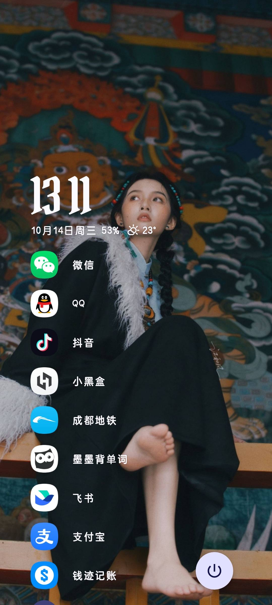
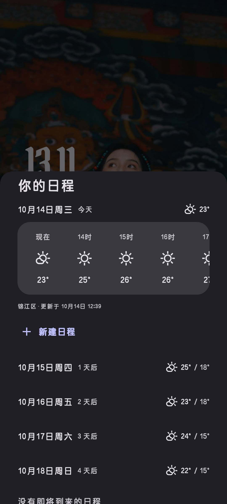
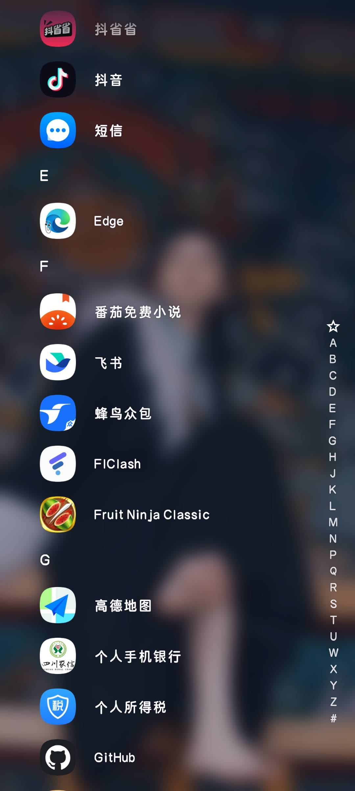
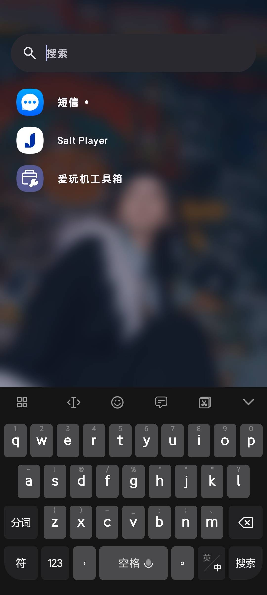
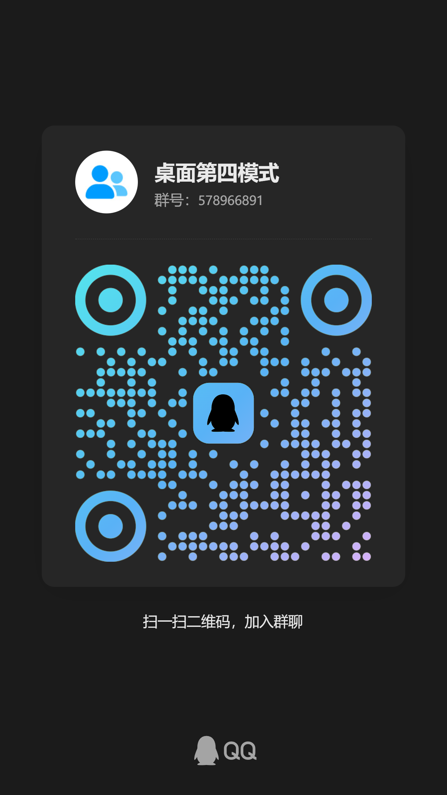

# HomeMode4Miui — MIUI Home 第四桌面模式 + GraceLauncher 移植

> 一个 LSPosed 模块，为小米桌面 `com.miui.home`（HyperOS）**以原生同款方式新增「第四种桌面模式」**——
> 不是换皮、不是借壳，而是真的 `class CustomLauncherMode extends LauncherMode`，与原生
> 经典 / 抽屉 / 极简 三种模式平级注册进宿主 `LauncherModeController`。
>
> 底座之上已全量移植 **GraceLauncher**（Kotlin + Jetpack Compose，GPL-3.0）桌面 UI，
> 运行在宿主 `com.miui.home` 进程内；设置全家桶与通知/媒体监听运行在模块 App 进程，
> 两进程经显式广播桥通信（天气由宿主进程直读小米天气 Provider，不依赖外部应用）。

支持宿主版本（**大版本自动判别**，`hook/HostCompat` 按 versionCode 分家族路由）：

| 家族 | 基准版本 | Hook 起点类 |
| --- | --- | --- |
| OS2（5.x） | `RELEASE-5.39.40.10843` | `com.miui.home.launcher.Launcher` |
| OS3（6.x） | `RELEASE-6.01.03.1927` | `com.miui.home.launcher.BaseLauncher`（OS3 的 Launcher 大重构，方法整体上移） |

当前版本：`2.9.96-autohide-fix`（versionCode 112），见 `app/build.gradle`。
最新 Release：[v2.9.96-autohide-fix](https://github.com/adaozi/HomeMode4Miui/releases/latest)。

## 效果预览

| 主屏（时钟 + 收藏列表） | 日程与天气（小米天气直读） |
| --- | --- |
|  |  |
| **应用列表（拼音字母索引）** | **全局搜索** |
|  |  |

## 交流与反馈

- QQ 群：**桌面第四模式**（群号 `578966891`）—— bug 反馈、功能建议、机型适配交流
- issue（含宿主版本号与导出日志）同样欢迎，见下方「安装与启用 → 日志导出」



---

## 目录

- [进程模型：先理解这个，后面全部成立](#进程模型先理解这个后面全部成立)
- [效果预览](#效果预览)
- [交流与反馈](#交流与反馈)
- [三类代码 + 一个桥](#三类代码--一个桥)
- [核心设计：为什么能"原生式"新增模式](#核心设计为什么能原生式新增模式)
- [Compose 宿主接桩：四个必解难题](#compose-宿主接桩四个必解难题)
- [跨进程桥（bridge/）](#跨进程桥bridge)
- [权限前置闸（gate）](#权限前置闸gate)
- [工程守则](#工程守则)
- [构建](#构建)
- [安装与启用](#安装与启用)
- [移植到其它小米桌面版本](#移植到其它小米桌面版本)
- [已知限制](#已知限制)
- [文档](#文档)

---

## 进程模型：先理解这个，后面全部成立

| 进程 | 职责 | 关键组件 |
| --- | --- | --- |
| **宿主** `com.miui.home`（LSPosed 注入） | 模式注册 / 视图挂载 / 手势隔离 / 桌面 UI 渲染 | `MainHook` + `hook/*` + `grace/*` + `com.galaxyrio.gracelauncher.**` |
| **模块 App** `com.homemode4miui` | 开关与设置页、通知/媒体监听、天气读取、保活引擎 | `MainActivity` + `SettingsActivity` + `bridge/*` + `MediaNotificationListener` |

两进程数据目录不互通 → 一切跨进程通信走三条路：

1. **宿主 SP**（`launcher_sharedpreference`）——模式开关、手势选项、保活就绪标志、熔断状态（`ModePrefs`）；
2. **显式包名广播**——设置/开关/命令（模块→宿主）、快照与命令（双向，`bridge/BridgeContract.kt`）；
3. **小米天气 Provider**——宿主进程内直读（`grace/GraceWeatherHostEngine`），进程内直推桌面，
   设置页随设置快照回带（v2.9.36 起取代原「外部 Breezy Weather 跨进程读」方案，MIUI 天气
   provider 有调用方白名单，宿主进程读取与系统天气部件同路径）。

## 三类代码 + 一个桥

```
app/src/main/java/com/homemode4miui/
├── MainHook.java              ① Hook 原版桌面（总入口，hook 点逐一隔离降级 + 失败清单上报首页）
├── hook/                      ① HostCompat（OS2/OS3 大版本判别 + hook 声明类路由）
│                                 / HomeController（挂载/隐藏）/ GestureIsolator（手势隔离）
├── mode/CustomLauncherMode    ② 唯一"进宿主"的类：extends LauncherMode，override 双签名覆盖两版本
├── home/                      ② UI 接缝：HomeView + HomeViewFactory + GraceHomeView + ModuleResourceBridge
├── grace/                     ② Compose 宿主层：GraceHomeRoot（路由）/ ViewModel / 设置宿主引擎
├── bridge/                    ★ 跨进程桥：广播契约 + 引擎 + 保活
├── PermissionGate.java        ★ 权限前置闸（宿主/模块两侧共用）
├── ModePrefs.java             ③ 宿主 SP 读写 + 切换链触发 + 熔断状态
├── MainActivity.java          ② 模块首页：开关 + 前置闸自检 + hook 失败提示 + 日志导出
├── SettingsActivity.kt        ② Grace 设置全家桶入口（模块 App 进程，Compose）
├── util/                      ② ModLog（全堆栈日志）/ LogExporter（日志导出）/ UiText
└── app/src/host/java/         ① 宿主类编译期桩（方法体 throw，运行期被真实类遮蔽）

app/src/main/java/com/galaxyrio/gracelauncher/   ② GraceLauncher 源码搬运层（GPL-3.0）
├── data/                      应用仓库 / Room（LauncherDatabase v21）/ 时钟 / 收藏 / 图标包 / 小米天气 / 媒体 / 通知
├── platform/                  AppWidgetHost（HOST_ID "GRAC"）/ 私密空间 / 系统动作封装
└── ui/                        home / drawer / search / overlays / widgets / settings / theme 全套 Compose
```

> 源码来源：GraceLauncher v1.1.9（github.com/Galaxy-rio/GraceLauncher，GPL-3.0），上游全部 tag 已同步（v1.1.4→v1.1.8 十个 tag；v1.1.9 五大功能：Grace Button 可移动与分区可见性、图标圆点/隐藏与主色重着色、主题调色板风格、文件夹成员自动隐藏、收藏编辑直达）。
> 移植决策与逐文件清单见 [`docs/PORTING_GraceLauncher.md`](docs/PORTING_GraceLauncher.md)。

## 核心设计：为什么能"原生式"新增模式

| 原生开发会做的事 | 本模块的等价实现 |
| --- | --- |
| `class CustomLauncherMode extends LauncherMode` | `mode/CustomLauncherMode.java`（真子类，惰性单例） |
| 在 `LauncherModeController` 注册单例 | hook `getAllModes()` after 追加实例 |
| 在 `loadCurrentLauncherMode()` 加分支 | hook 裁决入口（**自适应三级锚点**：`loadCurrentLauncher*` → `*resetcache*` → `getcurrentmode()`，全落空 dump 成员到日志） |
| 持久化 key 写进 `launcher_sharedpreference` | `ModePrefs` 写同文件新 key（`is_custom_mode_enable`） |
| 切换调用 `onLauncherModeChanged()` | 反射触发宿主 private static 方法，链路完全一致 |
| 模式行为差异写成 override | **override 双签名并存覆盖 OS2/OS3，0 个行为 hook** |
| 每模式独立布局数据库 | 自动获得 `databases/custom/launcher.db`（宿主按 `getModeName()` 拼路径） |

**Hook 点清单**（每个独立 try/catch，失败只降级该功能；失败清单随 pong/live 广播上报模块首页分级提示）：

| # | 目标 | 时机 | 作用 |
| - | --- | --- | --- |
| 0 | `Application.onCreate()` | after | **gate1 接收器前置**：ping 接收器注册 + 存活广播的最早锚点，与 Launcher 生命周期解耦 |
| 1 | `LauncherModeController.getAllModes()` | after | 注册第四模式 |
| 2 | 模式裁决（三级自适应锚点） | after/replace | 极简优先级保持原生语义 |
| 3 | `Launcher.setupViews()` | after | 缓存 Launcher、按模式挂载/卸载视图（声明类经 HostCompat 按大版本路由） |
| 3b | `Launcher.onCreate(Bundle)` | after | 挂载兜底锚点（两版本必经的生命周期方法） |
| 4 | `Launcher.onLauncherModeChanged()` | after | 原生切换链 UI 着陆点 |
| 5 | `Launcher.onResume()` | after | 回桌面校准 + 应用变更通知 |
| 9 | `SuperDraglayer.findActiveController()` | before | **手势隔离闸门**：自定义模式下宿主手势控制器永不认领手势流（负一屏恒定隔离） |
| 10 | `Launcher.onMinusOneScreenViewScroll()` | after | 负一屏关闭同步还原 |
| 11 | `Launcher.onNewIntent()` | after | Home 键回首页态回调；OS3 另挂 `onNewIntentWhenAlreadyOnHome` 新路径 |

**大版本路由**（`hook/HostCompat`）：hook 目标类按家族选起点（OS3→`BaseLauncher`，OS2→`Launcher`），
再沿父类链做**惰性精确签名匹配**（`getDeclaredMethod(name, params)`）找实际声明类。
⚠️ 铁律：对宿主类**严禁 `getDeclaredMethods()` 全量扫描**——它会急切解析所有方法签名，而
Launcher 父链引用独立包 `com.miui.newhome.*`（OS2/OS3 的宿主类路径上均缺失）→ `NoClassDefFoundError`
连环炸掉全部 Launcher hook（装机实锤）。排查工具：`tools/check_class_refs.py`（引用完整性静态分析）。

## Compose 宿主接桩：四个必解难题

宿主进程没有 Compose 运行时、没有 `ComponentActivity`，资源也不是模块的。四个坑全部解决在 `home/GraceHomeView.kt` + `grace/` 层：

1. **三 Owner 自实现**——`LifecycleOwner` / `ViewModelStoreOwner` / `SavedStateRegistryOwner` 挂到视图树，`GraceHomeViewModel` 手动构造传入（绕过 `viewModels()` 委托）；
2. **自托管 Recomposer**——`ComposeView` 默认走 `windowRecomposer()`，会从宿主窗口根视图找 `ViewTreeLifecycleOwner`，宿主没有 → 帧阶段异常（真机复现 18 次崩溃循环的根因）。改为自建 Recomposer 经 `setParentCompositionContext` 注入，该路径根本不会执行；
3. **持久化熔断**——挂载前在宿主 SP 落 pending，首帧**绘制完成后**心跳清除（`withFrameNanos` 之后回调）。若进程在心跳前死亡，pending 跨重启存活 → 失败计数，连续超阈值（`GRACE_MAX_FAILURES = 2`）**永久降级为占位视图**，桌面保可用；换 APK 版本自动清零重新放开；
4. **模块资源桥**——`LocalContext` 覆盖为模块包 Context（`createPackageContext`），`stringResource` / `Font(R.font.x)` 走模块资源表；需要宿主侧行为（filesDir / Activity window）的组件改用 `LocalHostContext`。

另有两道可靠性闸：`onHomeAttached` 复用路径幂等（onResume 重复进入只推生命周期，绝不重复挂 ComposeView）；组合一旦失败立即把 ComposeView 摘出视图树，残缺组合不进宿主帧管线。

## 跨进程桥（bridge/）

通知监听 / 媒体 Session / 天气源只能落在**模块 App 进程**，而 UI 在宿主进程 —— `bridge/BridgeContract.kt` 定义单向快照 + 命令上行的广播桥：

| 方向 | 通道 | 内容 |
| --- | --- | --- |
| 模块 → 宿主 | 显式广播（`setPackage("com.miui.home")`，宿主动态注册） | 媒体 NowPlaying JSON + 封面 bytes（限 512px）、通知快照（每 app ≤3 条 / 总量 ≤192KB，binder 安全区）、天气快照 |
| 宿主 → 模块 | 显式广播（`ACTION_GRACE_COMMAND`，引擎动态注册 + uid 校验） | 媒体控制、通知打开/清除、天气刷新、快照拉取 |

实机经验已固化在代码注释：MIUI/HyperOS 对 manifest 静态注册 receiver 有省电拦截（装机实锤零输出），命令接收器改为 `GraceBridgeEngine.start()` 动态注册；快照方向动态注册一直正常。

保活三闸（缺一则快照过期 → 宿主侧组件自然隐藏，不阻塞主链路）：

- `RootKeepAlive` —— su 探测 + Doze 白名单 / PowerKeeper / 自启动三连；
- `AutoStartProbe` —— AppOps 10008（自启动）授权探测；
- `GraceKeepAliveService` —— 宿主挂载期跨包 startService 拉起（引擎幂等），Magisk service.d 亦可经此入口拉起。

隐私红线：通知正文 / 媒体元数据仅在进程内存与广播 JSON 快照，从不持久化落盘、从不上传。

## 权限前置闸（gate）

**权限必须在模块首页确认齐备后才允许使用第四桌面**（`PermissionGate`，宿主/模块两侧共用判定）：

1. **LSPosed hook 生效**——首页 ping/pong 广播探测（宿主 `Application.onCreate` 锚点主动回 live）；
   pong 附带**宿主版本号 + 大版本家族（OS2/OS3）+ 未生效 hook 清单**，首页据此分级显示：
   全部生效 ✓ 绿 / 部分生效 ⚠ 黄（列出未生效项）/ **无法 hook 当前桌面 ✗ 红**（核心 hook
   失败时阻断开关，并引导导出日志反馈）；
2. **通知监听授权**——`Settings.Secure` 全局 `enabled_notification_listeners` 读取（不能用 `isNotificationListenerAccessGranted`：该 API 有 same-app 守卫，宿主进程查模块组件恒 false，5s TTL 缓存防裁决高频穿透 binder）；
3. **root 保活就绪**——su 探测只能由模块进程发起，结果广播写宿主 SP。

语义：SP 开关记住用户意愿，`allowed` 决定是否实际生效——权限补齐后无需重新开关，自动恢复；权限丢失后 onResume 自动回落原生（宿主侧裁决 hook 双保险）。

## 工程守则

1. **桌面零崩溃**：每个 hook 与每处回调独立 try/catch，失败降级并经 `util/ModLog` 打**全堆栈**，禁止静默吞异常；Compose 异常经 `CompositionError` 回调同样落 ModLog；
2. **语义化颜色**：UI 文本颜色必须走语义色层（壁纸适配对比度），禁止散落硬编码色值（Compose 侧由 Theme 层做壁纸取色映射）；
3. **零宿主资源依赖**：自绘 UI 不引用宿主 R 资源、不 inflate 宿主布局，不怕宿主换版换资源 ID；
4. **桩不执行**：`app/src/host/java/**` 方法体一律 `throw RuntimeException("HOST STUB")`，误执行显式失败而非静默错行为。

## 构建

技术栈：AGP 9.3.3 / Kotlin 2.4.20（compose 插件）/ Compose BOM 2026.09.00 / Room 2.8.4（KSP）/ minSdk 33 / targetSdk 34 / compileSdk 37 / **JDK 21**。R8 + shrinkResources 已开（31MB → 7.3MB，放行规则见 `app/proguard-rules.pro`）。

### 方式 A：Gradle

```bash
./gradlew assembleRelease
# 依赖：JDK 21 + android-37 + build-tools 36.1.0
# 本机环境清单与 maven 镜像（阿里云/腾讯）见 tools/ENV.md
```

### 方式 B：手动管线（无 Gradle）

```bash
JAVA_HOME=/path/to/jdk-21 \
ANDROID_HOME=/path/to/android-sdk \
bash tools/build_apk.sh
# 流程：javac → d8 → aapt2 compile/link → zipalign → apksigner（Windows/Git Bash 已适配）
```

> **签名提醒**：两个方式共用 `.build/ks/debug.keystore`（alias `homemode4miui`，密码 `android`）。
> 换签名安装前需**先卸载旧版**。

## 安装与启用

1. 安装 APK → LSPosed → 启用本模块，作用域勾选**系统桌面（`com.miui.home`）**；
2. 重启系统桌面；
3. 打开模块 App，完成**前置闸自检**（hook 生效 / 通知监听授权 / root 保活 / MIUI 自启动）
   —— 权限不齐或核心 hook 失败时开关禁用，首页明示缺项；
4. 开启第四桌面（开关经广播实时切换，写宿主 SP，走原生切换链）。

关闭即回原生模式。各模式布局互不覆盖（独立数据库目录）。

### 日志导出（bug 反馈）

模块首页「导出日志（bug 反馈用）」→ 选范围（最近 1 小时 / 30 分钟 / 10 分钟 / 5 分钟 / 1 分钟）
→ 保存到 **Download 文件夹**（首页显示完整路径），上限 10MB（超出保留最新部分）。

日志来源三级降级：① su 读 **LSPosed 模块日志**（`/data/adb/lspd/log/modules.log` 等，
宿主侧 hook 日志只在这里）；② su `logcat -d`；③ 无 root 时仅本进程 logcat（文件头会注明）。
文件头自带模块版本 / 机型 / Android 版本 / 来源等信息；提交反馈前请浏览确认无隐私内容。

## 移植到其它小米桌面版本

**详见 [`docs/PORTING.md`](docs/PORTING.md)**，核心结论：

- **大版本自动判别**：`hook/HostCompat` 按 versionCode 分 OS2/OS3 家族，hook 目标类按家族选
  起点（OS3→`BaseLauncher`，OS2→`Launcher`）再沿父链找声明类，未来方法继续上移自动跟随；
- **能自适应的**：hook 目标按名字特征扫描而非硬编码签名（裁决锚点、当前模式字段）；
- **能版本无关的**：隐藏原生表面用「容器子 View 记账」而非按类名；
- **必须手工适配的**：`LauncherMode` 抽象/覆写方法签名变化 → 改 `app/src/host/java/**` 桩 +
  `CustomLauncherMode` override（OS3 实例：`isHomeSupportIconSearchBar` 改无参、
  `canAddToFolder/canShowShortcutMenu` 参数改 `IShortcutInfo/IDragObject`——双签名并存覆盖两版本）；
- **反射铁律**：宿主类只允许 `getDeclaredMethod(name, params)` 惰性精确匹配，
  `getDeclaredMethods()` 全量扫描会因缺失类引用（`com.miui.newhome.*`）连环炸
  （排查工具 `tools/check_class_refs.py`）。

移植三步：反编译目标宿主核对签名（`tools/dump_class_methods.py --preset` / `check_class_refs.py`）
→ 同步宿主桩（唯一编译期契约）→ 装机看 LSPosed 日志 tag `HomeMode4Miui` 逐条核对
`hook installed` / `hook FAILED (degraded)`，或直接用模块首页「导出日志」。

## 已知限制

- **极简模式优先级高于自定义模式**（保持原生裁决语义）：使用前请先关闭系统极简模式；
- **负一屏手势恒定隔离**（无开关）：自定义模式下右滑不进负一屏，由自定义 UI 经
  `HomeController.openMinusOneScreen()` 主动打开；
- **OS3 尚有未逆向语义**：`LauncherMode.getSupportSearchBarType(int)` 常量含义未知
  （搜索条视觉接管由「原生表面隐藏」兜底）；`BaseLauncher.setupViews` 在 DI 化后是否仍为
  视图装配入口待真机确认（已加 `Launcher.onCreate`/`onResume` 双兜底锚点）；
- 广播桥时效性依赖保活：模块进程被杀且快照过期 = 宿主侧媒体/通知/天气组件自然空缺（隐藏），不阻塞主链路；
- 宿主启动转场（P5）走降级方案：宿主无 `ComponentActivity`，Compose 合约动画不可用。

## 文档

| 文件 | 内容 |
| --- | --- |
| [`docs/ARCHITECTURE.md`](docs/ARCHITECTURE.md) | 三类代码完整逐文件说明 + 调用链 + 数据获取知识存档 |
| [`docs/PORTING.md`](docs/PORTING.md) | 旧版/新版小米桌面适配清单、漂移防护机制、排错手册 |
| [`docs/PORTING_GraceLauncher.md`](docs/PORTING_GraceLauncher.md) | GraceLauncher 移植路线图（P0–P6）、上游 v1.1.4→v1.1.8 同步记录、风险登记、构建环境 |
| [`docs/SETUP_NEW_MACHINE.md`](docs/SETUP_NEW_MACHINE.md) | 换机开发指南（签名密钥 / Gradle 镜像 / 环境清单） |
| [`docs/CODE_AUDIT_2026-10-13.md`](docs/CODE_AUDIT_2026-10-13.md) | 全仓代码审计快照（v2.9.36 天气上移宿主架构，P0 修复见 v2.9.37） |
| [`docs/CODE_AUDIT_2026-10-16.md`](docs/CODE_AUDIT_2026-10-16.md) | 「写了但没实现」无效功能审计（181 文件交叉引用，整改见 v2.9.87） |
| [`docs/UISTATE_SPLIT_DESIGN.md`](docs/UISTATE_SPLIT_DESIGN.md) | GraceHomeUiState 拆分设计稿（未实施，随 P3+ 推进） |
| [`tools/ENV.md`](tools/ENV.md) | 本机开发环境清单（JDK 21 / SDK / Gradle 镜像） |

---

## 许可证

本模块包含 GraceLauncher（GPL-3.0）衍生代码，整体以 **GPL-3.0** 分发（见 `LICENSE`）。
字体资源见 `app/src/main/assets/fonts/licenses/`。
